# Final Project Report

## Project 1 — Smart Campus Resource & Lab Booking System

**Course:** ETCCMS304

**Submission:** Seven-phase capstone report

This report documents the implementation in `database/`, `nosql/mongo_demo.js`,
`app/server.js`, and `app/index.html`, together with the screenshots available
in this repository. The SQL seed script inserts 307 rows across its 13 tables.
That is the scripted seed total, not a guarantee of the current contents of a
database that has subsequently been used for testing.

> **Evidence-path note:** Advanced screenshots are stored in
> `screenshots/05_app_and_advanced/` in this checkout (rather than
> `screenshots/app_and_advanced/`). The savepoint evidence file is named
> `02_savepoint_and_concurrency.png.png`. Image links below use these actual
> repository paths. The `04_queries_and_functions` folder contains query
> result images; it does not contain separate before/after `EXPLAIN` images.

---

## Phase 1 — Requirement Analysis

### Problem statement

Campus laboratories, rooms, and specialized equipment are shared by multiple
departments. Informal reservation methods make it difficult to find available
assets, avoid overlapping time slots, account for maintenance outages, and
retain a reliable history of approvals and cancellations. Equipment telemetry
and inspection checklists also vary by asset and are not naturally represented
as a fixed set of relational columns.

### Objectives

1. Maintain one searchable inventory of resources, types, and campus locations.
2. Accept time-bounded booking requests and prevent overlapping active
   reservations, including concurrent submissions.
3. Preserve approval, cancellation, usage, and audit history.
4. Report resource availability, utilization, booking conflicts, and usage
   patterns.
5. Store flexible maintenance evidence and sensor telemetry in a document
   database while keeping booking transactions relational.
6. Provide a browser dashboard backed by an Express API.

### Scope

The project covers one campus inventory and its resource booking lifecycle:
users and roles, locations, resource types and resources, booking headers and
items, approvals, maintenance, usage logs, cancellation records, and audit
events. It includes a MySQL API and dashboard plus a MongoDB maintenance-report
extension.

Authentication, identity-provider integration, payments, calendar
synchronization, notifications, and production deployment/monitoring are not
implemented. The dashboard's user ID is a demo input, not a verified identity.

### Stakeholders

| Stakeholder | Main need |
| --- | --- |
| Students | Discover and request available lab/equipment time |
| Faculty and researchers | Schedule research and teaching resources |
| Lab assistants and technicians | Record equipment maintenance and inspections |
| Booking coordinators / administrators | Review requests, approve or reject, and audit changes |
| Department heads / resource owners | Understand demand and utilization for their assets |
| Campus IT / database administrators | Operate the service, manage privileges, and protect data |

### Functional requirements

- **FR1 — Inventory:** List resources with type, location, capacity, and current
  status; support text search and status/type filters.
- **FR2 — Booking request:** Accept user, resource, date/time range, and
  optional purpose; validate identifiers and strict time ordering.
- **FR3 — Conflict prevention:** Reject overlaps for the same resource while
  allowing exactly adjacent intervals.
- **FR4 — Availability:** Refuse booking when the resource is not `available`;
  display `under_maintenance` distinctly.
- **FR5 — Approval:** Permit a coordinator to confirm or reject a pending
  booking after rechecking conflicts and maintenance.
- **FR6 — Lifecycle:** List recent bookings and cancel eligible pending or
  confirmed reservations, retaining cancellation and audit records.
- **FR7 — Analytics:** Provide availability, conflict, utilization, department,
  monthly, and demand-versus-approval queries.
- **FR8 — Maintenance:** Record semi-structured technician reports, telemetry,
  checklists, cost, downtime, and severity; summarize reports by severity and
  status.

### Non-functional requirements

- **Integrity and consistency:** Use InnoDB foreign keys, `CHECK`/`ENUM`
  constraints, transactions, locks, and triggers.
- **Concurrency:** Serialize booking work on the resource row and test
  simultaneous requests for the same slot.
- **Security:** Parameterize search and booking SQL; restrict direct booking
  table writes through database roles.
- **Performance:** Index lookup and interval-query columns and compare query
  plans.
- **Usability:** Provide clear validation and conflict feedback, status badges,
  and refreshable resource/booking panels.
- **Maintainability:** Separate schema, seed data, routines/security, analytics,
  API, and document-store demo.
- **Availability:** Keep MySQL resource/booking features available when the
  optional MongoDB service is down.

### Business rules

1. A booking has a user, a date and time interval, and one or more resource
   items. The current creation procedure submits one resource item per call.
2. `end_time` must be strictly greater than `start_time`; each item quantity
   must be at least one.
3. A resource must have status `available` to be booked.
4. Two active `pending` or `confirmed` items for the same resource may not
   overlap. The overlap predicate is
   `new_start < existing_end AND new_end > existing_start`; an end equal to
   another start is therefore adjacent and allowed.
5. A new booking starts `pending`. Approval moves it to `confirmed`; rejection
   and cancellation release the time slot.
6. A booking cancellation creates a `CANCELLATION` record and an
   `AUDIT_LOG` transition.
7. Role policy columns describe maximum duration, advance notice, approval
   requirements, and concurrent-booking limits. These values are stored in
   `ROLE`; the current creation procedure does not enforce every policy field.

---

## Phase 2 — Conceptual Design

### Entities

The EER model covers the 13 relational entities: `DEPARTMENT`, `ROLE`, `USER`,
`LOCATION`, `RESOURCE_TYPE`, `RESOURCE`, `BOOKING`, `BOOKING_ITEM`, `APPROVAL`,
`MAINTENANCE`, `USAGE_LOG`, `CANCELLATION`, and `AUDIT_LOG`.
`maintenance_reports` is a separate MongoDB collection rather than a fourteenth
relational table.

### Relationships, cardinality, and participation

| Relationship | Cardinality | Participation / implementation |
| --- | --- | --- |
| `ROLE` to `USER` | 1:N | Every user has one role (`USER.role_id NOT NULL`); a role may have no users |
| `DEPARTMENT` to `USER` | 1:N | User department is optional (`department_id` nullable) |
| `RESOURCE_TYPE` to `RESOURCE` | 1:N | Every resource has a type (`resource_type_id NOT NULL`) |
| `LOCATION` to `RESOURCE` | 1:N | A resource may have no current location (`location_id` nullable) |
| `USER` to `BOOKING` | 1:N | Every booking references one user |
| `BOOKING` to `BOOKING_ITEM` | 1:N | Each item references one booking; the schema does not enforce at least one item per booking |
| `RESOURCE` to `BOOKING_ITEM` | 1:N | Each item reserves one resource; `(booking_id, resource_id)` is unique |
| `RESOURCE` to `MAINTENANCE` | 1:N | Each maintenance row references a resource |
| `BOOKING` to `APPROVAL` | 1:0..1 | `APPROVAL.booking_id` is unique |
| `BOOKING` to `CANCELLATION` | 1:0..1 | `CANCELLATION.booking_id` is unique |
| `BOOKING` to `USAGE_LOG` | 1:N | A booking may have multiple usage-log rows; there is no unique constraint on `USAGE_LOG.booking_id` |
| `BOOKING` to `AUDIT_LOG` | 1:N | A booking may accumulate multiple status/audit events |

Participation on each child side is mandatory where its foreign key is
`NOT NULL`; parent participation is generally optional. In particular,
`USAGE_LOG` is not constrained to one row per booking, and the relational
schema does not enforce a booking's minimum item count.

### Specialization and aggregation

The conceptual EER depicts a disjoint user specialization (student, faculty,
and staff/administrator) to express different user roles. In the implemented
relational design, these are represented by `USER.role_id` and policy rows in
`ROLE`, not by separate student/faculty/staff subtype tables. The policy
distinctions are therefore role data, not separate subtype attributes.

The many-to-many booking/resource association is represented by the
`BOOKING`–`BOOKING_ITEM`–`RESOURCE` aggregation: a booking header groups
resource-specific intervals and quantities. MongoDB embeds technician details,
telemetry, checklists, and replacement parts inside each maintenance report.

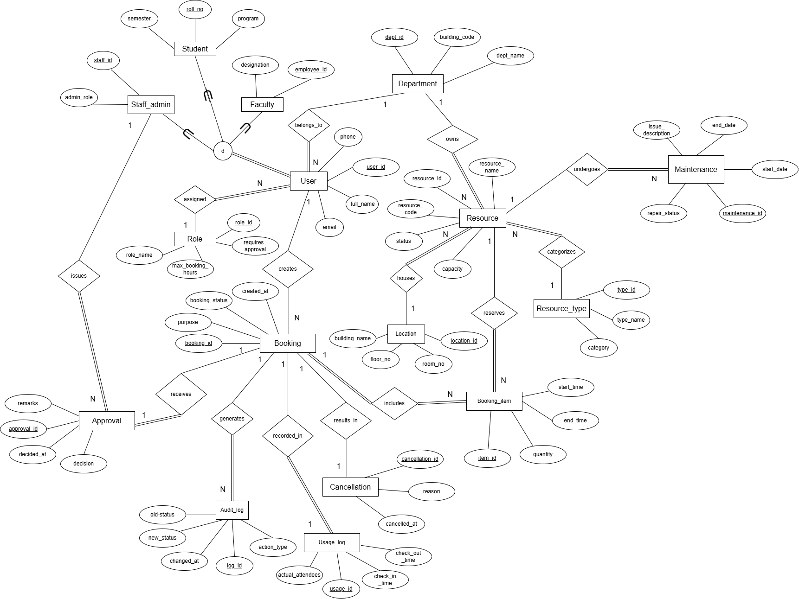

---

## Phase 3 — Relational Design and Normalization

### Relations, keys, and integrity constraints

The following matrix summarizes the DDL in
[`database/01_schema.sql`](../database/01_schema.sql). All tables use InnoDB.
`PK` means primary key; `FK` lists foreign keys; alternate keys and checks are
shown explicitly.

| Table | PK / alternate unique key | Foreign keys | UNIQUE and CHECK constraints |
| --- | --- | --- | --- |
| `ROLE` | `role_id`; `role_name` | — | `role_name` unique; `max_booking_hours > 0`, `max_advance_days > 0`, `concurrent_bookings > 0` |
| `DEPARTMENT` | `department_id`; `department_name` | — | `department_name` unique |
| `USER` | `user_id`; `email` | `role_id → ROLE` (`RESTRICT`); nullable `department_id → DEPARTMENT` (`SET NULL`) | `email` unique |
| `LOCATION` | `location_id`; `(building_name, floor_number, room_number)` | — | location tuple unique; nullable `capacity >= 0` |
| `RESOURCE_TYPE` | `resource_type_id`; `type_name` | — | `type_name` unique |
| `RESOURCE` | `resource_id`; `resource_code` | `resource_type_id → RESOURCE_TYPE` (`RESTRICT`); nullable `location_id → LOCATION` (`SET NULL`) | `resource_code` unique; nullable `capacity >= 0`; status enum: `available`, `occupied`, `under_maintenance`, `retired` |
| `BOOKING` | `booking_id` | `user_id → USER` (`RESTRICT`) | `total_resources >= 1`; `end_time > start_time`; status enum: `pending`, `confirmed`, `cancelled`, `completed`, `rejected` |
| `BOOKING_ITEM` | `booking_item_id`; `(booking_id, resource_id)` | `booking_id → BOOKING` (`CASCADE`); `resource_id → RESOURCE` (`RESTRICT`) | pair unique; `quantity >= 1`; `end_time > start_time` |
| `APPROVAL` | `approval_id`; `booking_id` | `booking_id → BOOKING` (`CASCADE`); `approver_id → USER` (`RESTRICT`) | `booking_id` unique; decision enum: `approved`, `rejected`, `pending` |
| `MAINTENANCE` | `maintenance_id` | `resource_id → RESOURCE` (`CASCADE`); nullable `reported_by`, `assigned_to → USER` (`SET NULL`) | priority enum: `low`, `medium`, `high`, `critical`; status enum: `open`, `in_progress`, `resolved`, `closed` |
| `USAGE_LOG` | `log_id` | `booking_id → BOOKING`, `resource_id → RESOURCE`, `user_id → USER` (all `CASCADE`) | checkout is null or later than check-in |
| `CANCELLATION` | `cancellation_id`; `booking_id` | `booking_id → BOOKING` (`CASCADE`); `cancelled_by → USER` (`RESTRICT`) | `booking_id` unique |
| `AUDIT_LOG` | `audit_id` | `booking_id → BOOKING` (`CASCADE`); `changed_by → USER` (`RESTRICT`) | action enum: `created`, `updated`, `confirmed`, `cancelled`, `rejected`, `completed`, `approval_granted`, `approval_denied`; `change_details` is JSON |

The table summarizes the declared `ON DELETE` actions. All declared foreign
keys use `ON UPDATE CASCADE`. Location/resource and selected maintenance-user
references become `NULL` on deletion where indicated; restrictive references
prevent deleting referenced users, types, resources, or roles.

### Candidate keys and functional dependencies

For each relation, the listed key determines the row attributes. Alternate
unique keys add the corresponding additional dependencies. The `LOCATION`
tuple is a declared unique key, although MySQL permits multiple `NULL` values
in unique indexes, so its practical alternate-key behavior depends on which
tuple components are populated.

| Relation | Candidate key(s) | Representative non-trivial functional dependency |
| --- | --- | --- |
| `ROLE` | `role_id`, `role_name` | `role_id → role_name, max_booking_hours, max_advance_days, requires_approval, concurrent_bookings, description` |
| `DEPARTMENT` | `department_id`, `department_name` | `department_id → department_name, head_of_dept, contact_email, phone` |
| `USER` | `user_id`, `email` | `user_id → first_name, last_name, email, password_hash, phone, role_id, department_id, is_active` |
| `LOCATION` | `location_id`, declared location tuple | `location_id → building_name, floor_number, room_number, campus, capacity` |
| `RESOURCE_TYPE` | `resource_type_id`, `type_name` | `resource_type_id → type_name, description` |
| `RESOURCE` | `resource_id`, `resource_code` | `resource_id → resource_code, resource_name, resource_type_id, location_id, capacity, status, description` |
| `BOOKING` | `booking_id` | `booking_id → user_id, booking_date, start_time, end_time, purpose, status, total_resources` |
| `BOOKING_ITEM` | `booking_item_id`, `(booking_id, resource_id)` | `(booking_id, resource_id) → start_time, end_time, quantity, notes` |
| `APPROVAL` | `approval_id`, `booking_id` | `booking_id → approver_id, decision, remarks, decided_at` |
| `MAINTENANCE` | `maintenance_id` | `maintenance_id → resource_id, reported_by, assigned_to, issue_title, description, priority, status, reported_at, resolved_at` |
| `USAGE_LOG` | `log_id` | `log_id → booking_id, resource_id, user_id, check_in_time, check_out_time, actual_usage` |
| `CANCELLATION` | `cancellation_id`, `booking_id` | `booking_id → cancelled_by, reason, cancelled_at` |
| `AUDIT_LOG` | `audit_id` | `audit_id → booking_id, changed_by, action, old_status, new_status, change_details, ip_address, user_agent, changed_at` |

These dependencies follow the declared primary/unique keys and the intended
meaning of the attributes. They do not assume that descriptive values such as
resource names are unique. Formally, for each candidate key `K` in the table,
`K → R − K` (all remaining stored attributes); the matrix lists the principal
business attributes for readability.

### Normalization proof

- **1NF:** Each row has a primary key and the ordinary relational columns store
  single values rather than repeating groups. `BOOKING_ITEM` separates
  per-resource booking details. `AUDIT_LOG.change_details` is intentionally a
  JSON value; it is treated as one opaque SQL attribute here. If its internal
  keys need relational filtering or constraints, those fields should be
  decomposed into relational columns/tables.
- **2NF:** The main primary keys are single-column surrogate keys, so there are
  no partial dependencies on a proper subset of those primary keys. The
  additional candidate key `(booking_id, resource_id)` in `BOOKING_ITEM`
  represents a resource-specific time window; the design does not assert that
  those times depend on only one component.
- **3NF:** Role policy attributes are stored in `ROLE`, resource-type
  descriptors in `RESOURCE_TYPE`, and location descriptors in `LOCATION`
  instead of being repeated on every user/resource row. Booking lifecycle
  events are separated into `APPROVAL`, `CANCELLATION`, `USAGE_LOG`, and
  `AUDIT_LOG`.
- **BCNF:** Under the stated functional dependencies, every non-trivial
  determinant is a candidate key or a superkey: primary-key dependencies and
  declared unique-key dependencies are key-based. The `LOCATION` nullable
  alternate key and JSON attribute are the qualifications described above.

### Schema evidence

The following table-output screenshots are the available schema-folder
evidence. The DDL matrix above is authoritative for constraints.

<details>
<summary>Open the 13-table screenshot gallery</summary>

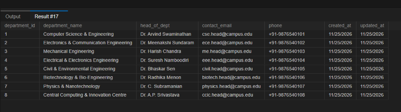
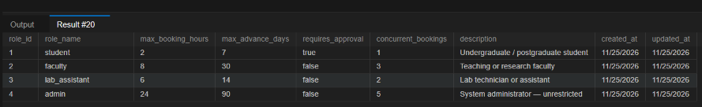
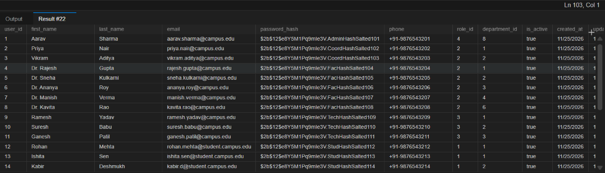
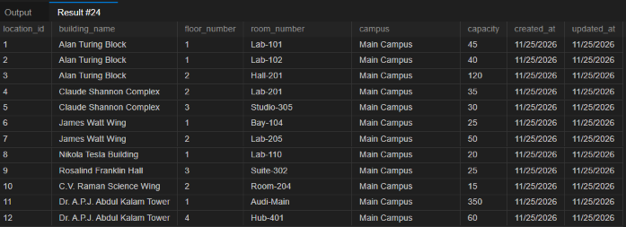
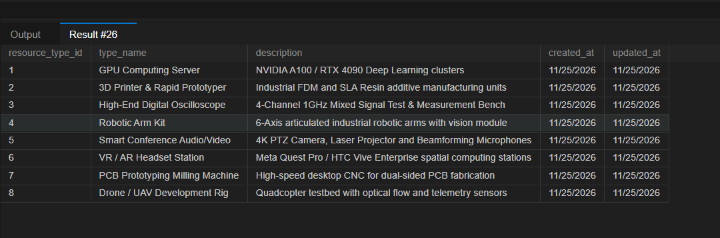
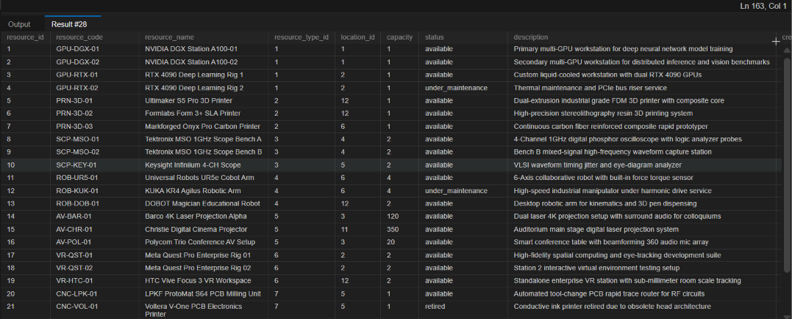
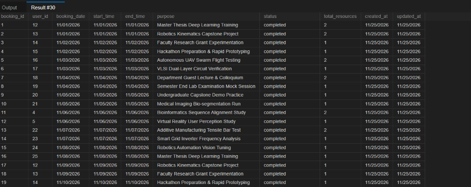
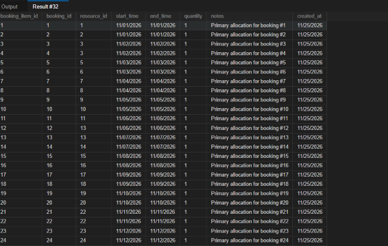
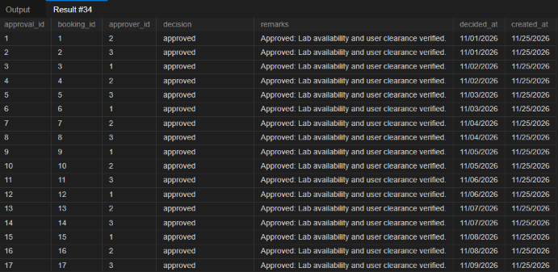
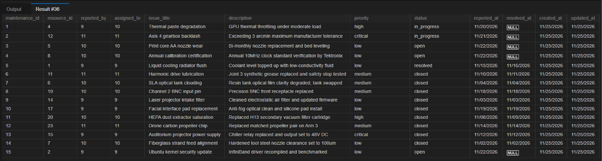
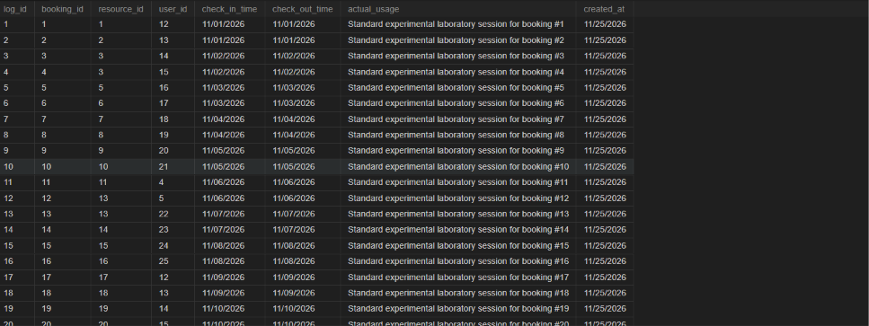
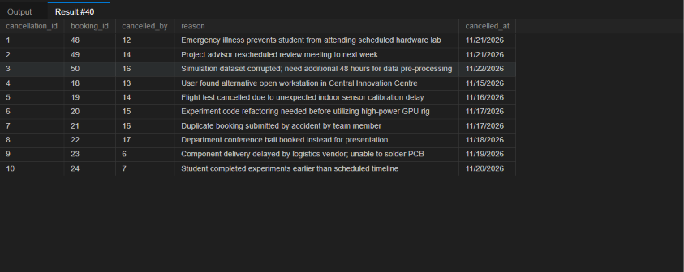
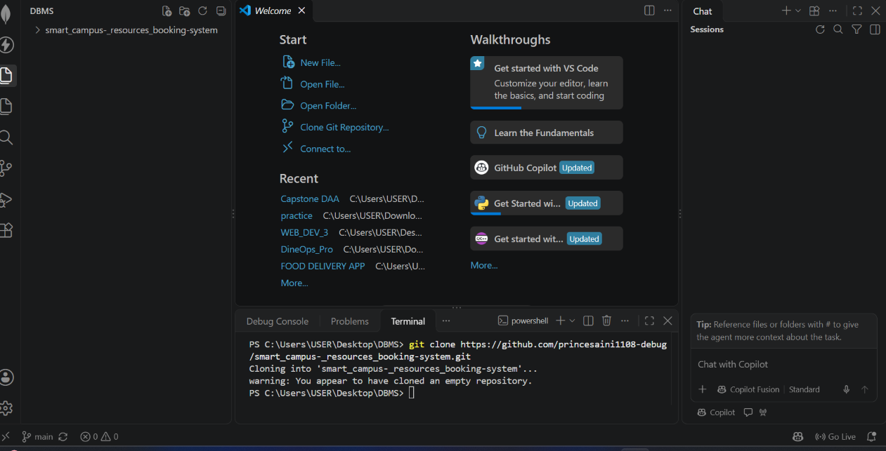

</details>

---

## Phase 4 — SQL Implementation and Analytics

### Seed dataset

`database/02_seed.sql` provides a deterministic, referentially linked sample
dataset. Per-table insert counts total **307**:

| Table | Rows | Table | Rows |
| --- | ---: | --- | ---: |
| `ROLE` | 4 | `DEPARTMENT` | 8 |
| `USER` | 25 | `LOCATION` | 12 |
| `RESOURCE_TYPE` | 8 | `RESOURCE` | 25 |
| `BOOKING` | 50 | `BOOKING_ITEM` | 60 |
| `APPROVAL` | 35 | `MAINTENANCE` | 15 |
| `USAGE_LOG` | 25 | `CANCELLATION` | 10 |
| `AUDIT_LOG` | 30 | **Total** | **307** |

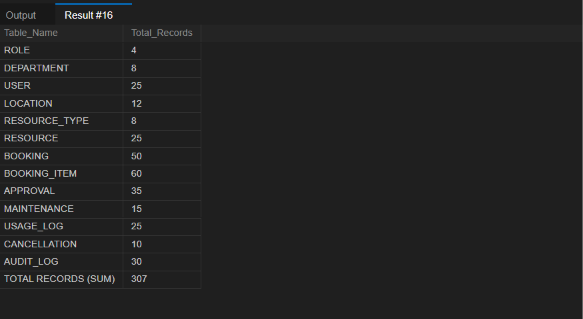

### Approval procedure and utilization function

`sp_approve_booking` starts a transaction, locks the target booking
(`BOOKING ... FOR UPDATE`), then locks the booking's resources in ascending
resource order before checking status or overlaps. Approval rejects conflicts
with confirmed/completed reservations or active maintenance, then updates the
booking, writes an `APPROVAL` row, and appends an audit record. An exception
handler rolls back. Rejection follows the same transactional lifecycle.

`fn_resource_utilization(resource_id, start, end)` calculates the percentage
of a requested window occupied by confirmed/completed booking items. It clips
each overlap with `GREATEST(item.start_time, window_start)` and
`LEAST(item.end_time, window_end)`, divides booked seconds by total window
seconds, returns zero for an invalid/empty window, and caps the result at
100%. It is declared `NOT DETERMINISTIC READS SQL DATA` because its result
depends on current booking rows.

### Seven analytical queries

The runnable SQL is in
[`database/04_queries_and_functions.sql`](../database/04_queries_and_functions.sql).
The following source excerpts show each query's actual tables, predicates, and
analytics; the linked SQL file contains the complete statements and output
columns.

1. **Interval availability:** `NOT EXISTS` excludes resources with maintenance
   or active bookings intersecting a requested window.

   ```sql
   SELECT r.resource_id, r.resource_code, r.resource_name
   FROM RESOURCE r
   JOIN RESOURCE_TYPE rt ON r.resource_type_id = rt.resource_type_id
   JOIN LOCATION l ON r.location_id = l.location_id
   WHERE r.status = 'available'
     AND NOT EXISTS (
       SELECT 1
       FROM MAINTENANCE m
       WHERE m.resource_id = r.resource_id
         AND m.status IN ('open', 'in_progress')
         AND m.reported_at < '2026-11-26 14:00:00'
         AND COALESCE(m.resolved_at, '2099-12-31') > '2026-11-26 10:00:00'
     )
     AND NOT EXISTS (
       SELECT 1
       FROM BOOKING_ITEM bi
       JOIN BOOKING b ON bi.booking_id = b.booking_id
       WHERE bi.resource_id = r.resource_id
         AND b.status IN ('confirmed', 'pending', 'completed')
         AND bi.start_time < '2026-11-26 14:00:00'
         AND bi.end_time > '2026-11-26 10:00:00'
     );
   ```

2. **Conflict detection:** a self-join pairs distinct booking items for the
   same resource and reports intersecting intervals and overlap duration.

   ```sql
   SELECT r.resource_code, b1.booking_id AS booking_1_id,
          b2.booking_id AS booking_2_id,
          TIMESTAMPDIFF(
            MINUTE,
            GREATEST(bi1.start_time, bi2.start_time),
            LEAST(bi1.end_time, bi2.end_time)
          ) AS overlap_duration_mins
   FROM BOOKING_ITEM bi1
   JOIN BOOKING_ITEM bi2
     ON bi1.resource_id = bi2.resource_id
    AND bi1.booking_item_id < bi2.booking_item_id
   JOIN BOOKING b1 ON bi1.booking_id = b1.booking_id
   JOIN BOOKING b2 ON bi2.booking_id = b2.booking_id
   JOIN RESOURCE r ON bi1.resource_id = r.resource_id
   WHERE b1.status NOT IN ('cancelled', 'rejected')
     AND b2.status NOT IN ('cancelled', 'rejected')
     AND bi1.start_time < bi2.end_time
     AND bi1.end_time > bi2.start_time;
   ```

3. **Resource ranking:** aggregates booking hours, then uses
   `DENSE_RANK() OVER (PARTITION BY resource_type ...)` and campus-wide
   `RANK()`.

   ```sql
   SELECT rt.type_name, r.resource_code, r.resource_name,
          COUNT(bi.booking_item_id) AS total_sessions,
          SUM(TIMESTAMPDIFF(MINUTE, bi.start_time, bi.end_time)) / 60.0 AS total_hours,
          DENSE_RANK() OVER (
            PARTITION BY rt.resource_type_id
            ORDER BY SUM(TIMESTAMPDIFF(MINUTE, bi.start_time, bi.end_time)) DESC
          ) AS category_rank,
          RANK() OVER (
            ORDER BY SUM(TIMESTAMPDIFF(MINUTE, bi.start_time, bi.end_time)) DESC
          ) AS campus_rank
   FROM RESOURCE r
   JOIN RESOURCE_TYPE rt ON r.resource_type_id = rt.resource_type_id
   LEFT JOIN BOOKING_ITEM bi ON r.resource_id = bi.resource_id
   LEFT JOIN BOOKING b ON bi.booking_id = b.booking_id
                      AND b.status IN ('confirmed', 'completed')
   GROUP BY rt.resource_type_id, rt.type_name,
            r.resource_id, r.resource_code, r.resource_name
   ```

   The production query also uses `COALESCE` and rounds the hour total so
   resources with no booking items remain visible with zero hours. One
   implementation caveat: the source places the confirmed/completed predicate
   on the `LEFT JOIN BOOKING`, but aggregates `BOOKING_ITEM` rows regardless of
   whether that join matched. Thus its totals can include items from other
   statuses; filter the aggregate by `b.booking_id` (or prefilter booking rows)
   if only confirmed/completed usage is intended.

4. **Department usage versus average:** a `DepartmentUsage` CTE computes
   confirmed/completed hours per department; an `InstitutionalAverage` CTE
   computes the comparison baseline, and the outer query returns departments
   above it.

   ```sql
   WITH DepartmentUsage AS (
          SELECT d.department_id, d.department_name,
                 COUNT(DISTINCT b.booking_id) AS total_bookings,
                 SUM(TIMESTAMPDIFF(MINUTE, bi.start_time, bi.end_time)) / 60.0
                   AS total_dept_hours
          FROM DEPARTMENT d
          LEFT JOIN `USER` u ON d.department_id = u.department_id
          LEFT JOIN BOOKING b ON u.user_id = b.user_id
                             AND b.status IN ('confirmed', 'completed')
          LEFT JOIN BOOKING_ITEM bi ON b.booking_id = bi.booking_id
          GROUP BY d.department_id, d.department_name
        ),
        InstitutionalAverage AS (
          SELECT AVG(total_dept_hours) AS avg_institutional_hours
          FROM DepartmentUsage
        )
   SELECT du.department_name, du.total_bookings, du.total_dept_hours,
          ia.avg_institutional_hours
   FROM DepartmentUsage du
   CROSS JOIN InstitutionalAverage ia
   WHERE du.total_dept_hours > ia.avg_institutional_hours;
   ```

5. **Monthly trend:** groups by `DATE_FORMAT(created_at, '%Y-%m')`, computes
   totals and lifecycle counts, and uses `LAG(operational_hours)` for the
   previous month.

   ```sql
   WITH MonthlyMetrics AS (
     SELECT DATE_FORMAT(b.created_at, '%Y-%m') AS booking_month,
            COUNT(b.booking_id) AS total_reservations,
            SUM(CASE WHEN b.status = 'completed' THEN 1 ELSE 0 END) AS completed_count,
            SUM(CASE WHEN b.status = 'confirmed' THEN 1 ELSE 0 END) AS confirmed_count,
            SUM(CASE WHEN b.status = 'cancelled' THEN 1 ELSE 0 END) AS cancelled_count,
            SUM(CASE WHEN b.status = 'rejected' THEN 1 ELSE 0 END) AS rejected_count,
            SUM(CASE WHEN b.status IN ('confirmed', 'completed')
                     THEN TIMESTAMPDIFF(MINUTE, bi.start_time, bi.end_time) / 60.0
                     ELSE 0 END) AS operational_hours
     FROM BOOKING b
     LEFT JOIN BOOKING_ITEM bi ON b.booking_id = bi.booking_id
     GROUP BY DATE_FORMAT(b.created_at, '%Y-%m')
   )
   SELECT booking_month, total_reservations, operational_hours,
          LAG(operational_hours, 1) OVER (ORDER BY booking_month) AS prev_month_hours
   FROM MonthlyMetrics;
   ```

6. **Current availability view:** `v_current_availability` uses `NOW()` to
   classify each asset as available, in use, under maintenance, or retired;
   it includes the current occupant where applicable.

   ```sql
   CREATE OR REPLACE VIEW v_current_availability AS
   SELECT r.resource_id, r.resource_code, r.resource_name,
          CASE
            WHEN r.status = 'retired' THEN 'Retired / Decommissioned'
            WHEN r.status = 'under_maintenance' OR EXISTS (
              SELECT 1 FROM MAINTENANCE m
              WHERE m.resource_id = r.resource_id
                AND m.status IN ('open', 'in_progress')
            ) THEN 'Under Maintenance'
            WHEN EXISTS (
              SELECT 1
              FROM BOOKING_ITEM bi
              JOIN BOOKING b ON bi.booking_id = b.booking_id
              WHERE bi.resource_id = r.resource_id
                AND b.status IN ('confirmed', 'completed')
                AND NOW() BETWEEN bi.start_time AND bi.end_time
            ) THEN 'In Use (Occupied)'
            ELSE 'Available Now'
          END AS live_operational_status
   FROM RESOURCE r
   JOIN RESOURCE_TYPE rt ON r.resource_type_id = rt.resource_type_id
   JOIN LOCATION l ON r.location_id = l.location_id;
   ```

7. **Demand-versus-approval set comparison:** the script demonstrates both an
   anti-join/`NOT IN` query and a native `EXCEPT` set operation to find
   requested resources with no confirmed/completed reservation.

   ```sql
   SELECT r.resource_id, r.resource_code, r.resource_name, rt.type_name
   FROM RESOURCE r
   JOIN RESOURCE_TYPE rt ON r.resource_type_id = rt.resource_type_id
   WHERE r.resource_id IN (
     SELECT DISTINCT resource_id FROM BOOKING_ITEM
   )
   EXCEPT
   SELECT r.resource_id, r.resource_code, r.resource_name, rt.type_name
   FROM RESOURCE r
   JOIN RESOURCE_TYPE rt ON r.resource_type_id = rt.resource_type_id
   JOIN BOOKING_ITEM bi ON r.resource_id = bi.resource_id
   JOIN BOOKING b ON bi.booking_id = b.booking_id
   WHERE b.status IN ('confirmed', 'completed');
   ```

### Query output evidence

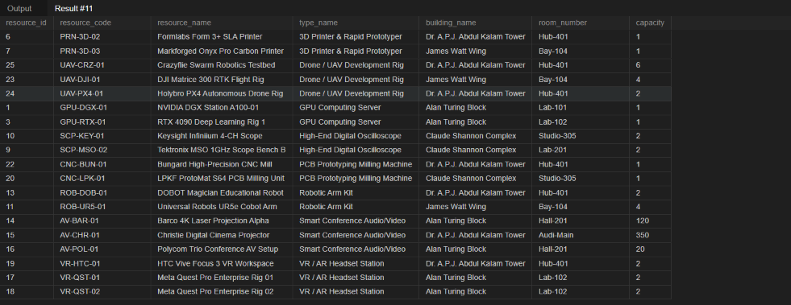
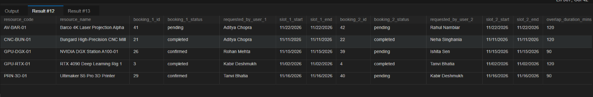
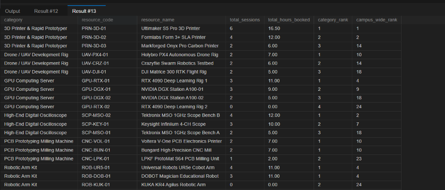
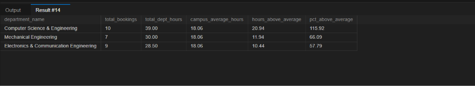
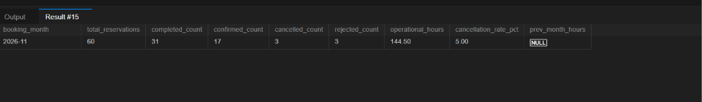
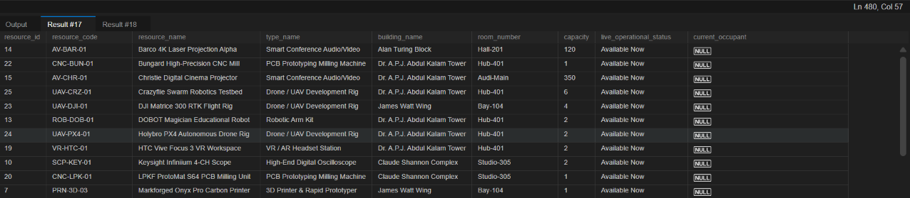
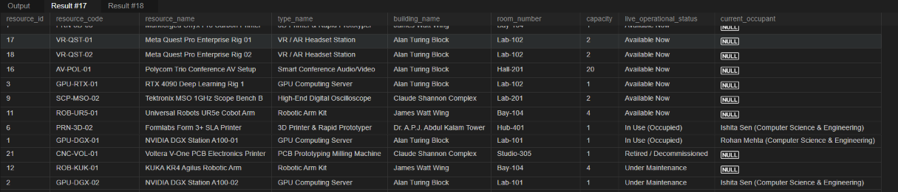
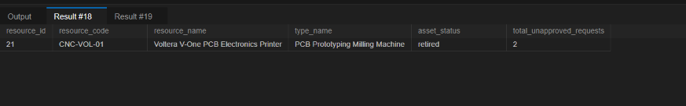
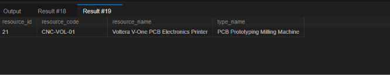

### Index optimization

The script runs the same interval lookup through `EXPLAIN ANALYZE` before and
after adding:

```sql
CREATE INDEX idx_booking_item_res_time
ON BOOKING_ITEM (resource_id, start_time, end_time);
```

The leading `resource_id` supports equality filtering; start/end are then
available to evaluate interval boundaries. `SHOW INDEX` verifies the new
index. The checked-in `04_queries_and_functions` screenshot folder contains
query result screenshots but no separate before/after `EXPLAIN ANALYZE`
screenshots, so no plan-cost or rows-examined improvement is claimed here.

---

## Phase 5 — Transactions, Concurrency, and Security

### Triggers and booking transaction

`trg_booking_item_before_insert_overlap` runs before each booking-item insert.
It checks active `pending` and `confirmed` bookings for the same resource with
the half-open interval overlap test and signals SQLSTATE `45000` if a conflict
exists. `trg_booking_after_update_cancel` records a cancellation and audit
entry when a booking transitions to `cancelled`.

`sp_create_booking` starts a transaction and locks the target resource row:

```sql
START TRANSACTION;
SELECT status INTO v_resource_status
FROM RESOURCE
WHERE resource_id = p_resource_id
FOR UPDATE;

IF v_resource_status <> 'available' THEN
  SIGNAL SQLSTATE '45000'
    SET MESSAGE_TEXT = 'Resource is not available for booking';
END IF;
```

It validates time ordering, inserts a `pending` booking and its item, writes a
creation audit entry, then commits. Its exception handler rolls back and
resignals the database error. Resource-row locking serializes concurrent
requests for the same asset before the overlap trigger check.

### Approval and savepoint transactions

The approval procedure locks the booking and each referenced resource before
checking for collisions and changing status. It commits approval/rejection
records atomically or rolls back on conflict/error.

The third TCL demonstration in `03_triggers_and_rbac.sql` creates a temporary
table, runs `START TRANSACTION`, inserts a required step, creates a
`SAVEPOINT`, inserts an optional step, executes `ROLLBACK TO SAVEPOINT`, then
commits. A final query shows only the required step remains. The temporary
table is dropped afterward; the example does not alter seeded booking rows.

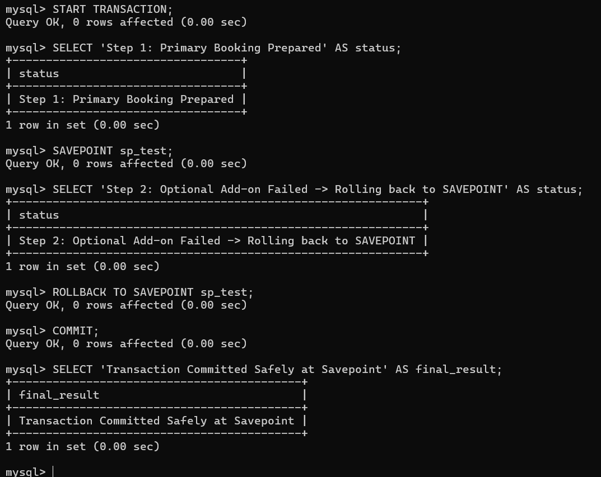

### Two-session concurrency scenario

Two independent API clients submit the same available resource and identical
future interval at the same time. The resource lock serializes the procedure
calls: one inserts and commits a `pending` booking; the second then reaches
the overlap check and receives SQLSTATE `45000`. The live test result was
exactly one HTTP `201` and one HTTP `409`, with one booking persisted for the
slot. This result is reported from the recorded E2E verification; the
savepoint screenshot above is not itself a two-session concurrency trace.

### Database roles and SQL-injection defense

| Role | Relevant privileges |
| --- | --- |
| `student_role` | Read resource/booking data; execute `sp_create_booking`; no direct booking/item `INSERT` or `UPDATE` |
| `faculty_role` | Read resource/booking data; execute `sp_create_booking`; approval and cancellation table permissions as granted |
| `admin_role` | Operational table management privileges, with `DELETE` revoked on `AUDIT_LOG` |

The SQL creates roles but does not create login accounts or grant roles to
accounts; production setup must explicitly assign and activate roles. The
Express resource search uses MySQL2 prepared statements (`LIKE ?`) and binds
the search pattern rather than interpolating user text. The injection probe
returned HTTP `200` with `[]`.

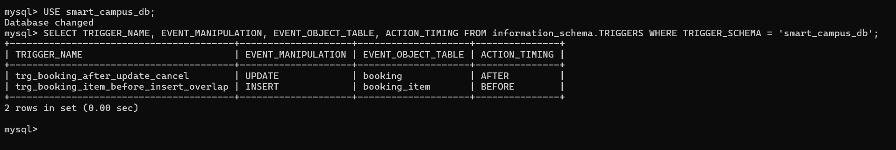

---

## Phase 6 — CO4 Extension: MongoDB and Application Integration

### Maintenance-report document

The MongoDB collection is `smart_campus_nosql.maintenance_reports`. Each
document references a relational `resource_id`/`resource_code` and embeds
variable report data. A representative shape is:

```javascript
{
  report_id: "MR-2026-001",
  resource_id: 1,
  resource_code: "GPU-DGX-01",
  equipment_name: "Campus equipment",
  category: "GPU Computing Server",
  severity: "Low",
  status: "Open",
  inspection_date: ISODate("2026-11-15T13:00:00Z"),
  technician: { name: "Technician", staff_id: "TECH-09" },
  sensor_telemetry: { peak_gpu_temp_celsius: 72.4, fan_rpm: 3800 },
  checklist: [{ check_item: "Cooling inspection", passed: true }],
  parts_replaced: [{ part_name: "Replacement part", quantity: 1 }],
  total_cost_usd: 125,
  downtime_hours: 6
}
```

`nosql/mongo_demo.js` seeds 15 varied documents, performs reads with nested
filters/projections, updates a report using `$set` and `$push`, deletes a
temporary test document, and runs an aggregation grouped by equipment
category. The aggregation computes incident counts, maintenance cost and
downtime totals/averages, and high/critical incident counts. The script starts
by dropping the collection; run it only in an isolated demo database.

### Relational versus document storage

| MySQL | MongoDB |
| --- | --- |
| Strongly related booking, user, resource, approval, and audit records | Flexible inspection reports with asset-specific fields |
| Foreign keys, checks, transactions, locks, and overlap enforcement | Embedded telemetry, checklists, technician metadata, and parts |
| SQL joins and window/CTE analytics | Document CRUD and aggregation pipeline |
| Authoritative reservation lifecycle | Supplemental maintenance evidence; `resource_id` is a reference, not a cross-database foreign key |

### Express and browser integration

`app/server.js` serves the static dashboard and exposes:

- `GET /api/resources` (parameterized search)
- `GET /api/bookings` (latest 25 booking headers with resource/user labels)
- `POST /api/bookings` (validates and calls `sp_create_booking`)
- `DELETE /api/bookings/:id` (transactionally changes eligible bookings to
  `cancelled`; the trigger records cancellation/audit and the slot is released)
- `GET` and `POST /api/maintenance-reports` (MongoDB listing/aggregation and
  report creation)

The frontend loads resource inventory, filters by status/type, limits the
booking selector to available resources, validates time ranges, submits
requests, displays recent bookings, and refreshes the inventory after
creation/cancellation. Its MongoDB panel shows report cards and aggregation
summaries and supports adding a report. MongoDB failures do not disable
MySQL-backed booking operations; MongoDB routes respond with service
unavailable when the service cannot be reached.

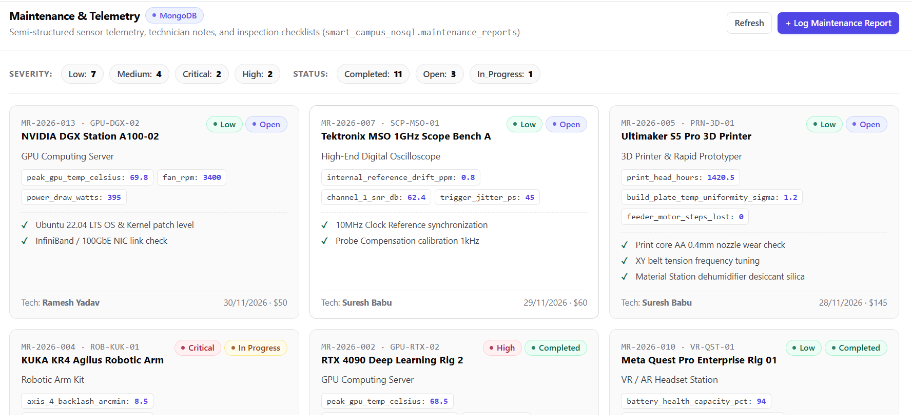

---

## Phase 7 — Testing and Demonstration

### Verification matrix

The results below summarize the completed project verification. HTTP codes
refer to the Express API; SQL-level results were checked in MySQL.

| Test | Expected behavior | Observed result |
| --- | --- | --- |
| Schema and seed | 13 tables and at least 200 seed rows | 13 tables; SQL seed inserts total 307 rows |
| Stored object smoke checks | View and utilization function execute | `v_current_availability` and `fn_resource_utilization` executed without runtime SQL errors |
| Resource list | `GET /api/resources` returns inventory and statuses | HTTP `200`; both `available` and `under_maintenance` resources present |
| Valid booking | Create future free slot through procedure | HTTP `201`; `booking_id` returned and row status `pending` |
| Overlap rejection | Reject intersecting slot for same resource | HTTP `409`; trigger's SQLSTATE `45000` message returned |
| Booking transaction rollback | A trigger failure after booking-header insertion must roll back the header and item atomically | Source path is guarded by the procedure's `SQLEXCEPTION` rollback handler; overlap returned HTTP `409` |
| Adjacent slot | Permit a slot whose start equals the previous end | HTTP `201` |
| Unavailable resource | Reject `under_maintenance` asset | HTTP `400`; descriptive unavailable-resource message |
| Time/quantity constraints | Reject `end_time <= start_time` and `quantity < 1` | API time validation returns HTTP `400`; database `CHECK` constraints and `ER_CHECK_CONSTRAINT_VIOLATED` mapping are present; a direct invalid-quantity SQL attempt was not separately captured |
| Concurrent identical requests | Exactly one winner and one conflict | One HTTP `201`, one HTTP `409`, and one persisted row for the slot |
| Savepoint rollback | Roll back only work after a savepoint, then commit the earlier work | SQL demonstration and screenshot show rollback-to-savepoint followed by commit |
| Search injection probe | Treat input as search text, not SQL | HTTP `200`, empty array `[]` |
| RBAC | Procedure execution allowed; direct destructive table access denied | Role has `EXECUTE`; procedure invocation reached its business-rule signal in the role test; direct `DELETE` was denied with privilege error 1142 |
| Booking cancellation | Release slot while preserving lifecycle history | HTTP `200`; booking status became `cancelled`, trigger wrote history, slot could be reused; missing ID returned HTTP `404` |
| MongoDB demo | Persist and query flexible maintenance documents | 15 demo documents inserted; CRUD and category aggregation are present in the script and evidence |

The repeatable seed script's designed total is 307. At the prior live E2E
verification, the database count exceeded that seed snapshot because an
unrelated non-test booking and its related records were intentionally retained;
temporary test bookings were cleaned up. The seed total must not be mistaken
for the live database's later row count.

### Demonstration evidence

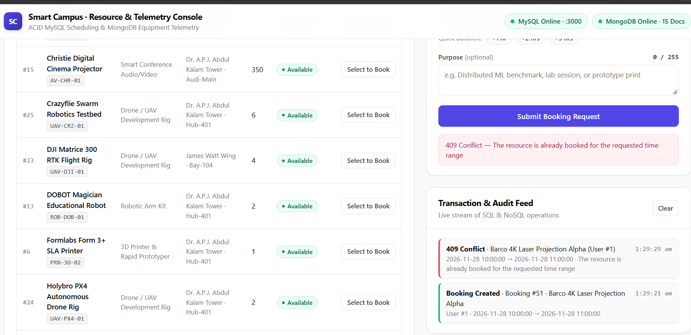

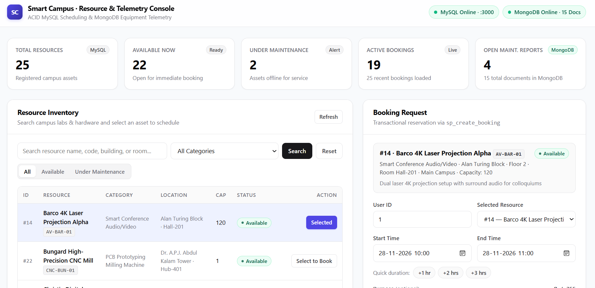

The MongoDB panel evidence is embedded in Phase 6. The savepoint screenshot is
embedded in Phase 5. The screenshot folder has no dedicated capture of the
two-session race or before/after execution plans; those results are supported
by the recorded API/database verification and the runnable SQL benchmark,
respectively.

---

## Conclusion

The project combines a normalized relational booking core with transactional
resource locking, interval-conflict checks, lifecycle auditing, role-based
privileges, and analytical SQL. A small Express service and browser dashboard
expose the booking lifecycle, while MongoDB holds variable maintenance and
telemetry documents. The design separates conceptual requirements from
implemented enforcement and identifies the remaining boundaries: no
authentication, no physical user subtype tables, no enforced role-duration
limits in the creation procedure, and no checked-in before/after EXPLAIN or
two-session race screenshots.
